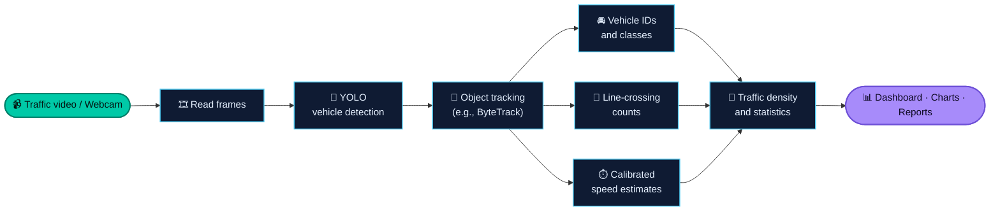
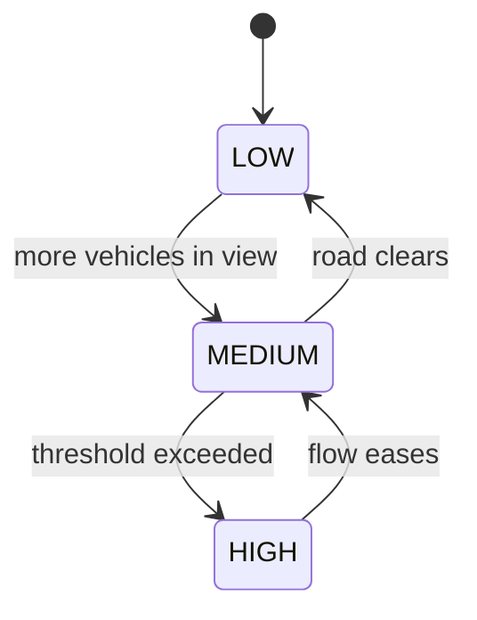

<a id="readme-top"></a>

<div align="center">



<br/>

<a href="#-quick-start">
  
</a>

<p>
  
  
  
  
</p>

<p>
  
  
  
</p>

<!--
  Live repo badges: replace YOUR_USERNAME/YOUR_REPO, then uncomment.
<p>
  
  
  
  
</p>
-->

**A computer-vision project that turns live camera feeds and traffic videos into actionable traffic insights.**

<br/>

[✨ About](#-about-the-project) &nbsp;•&nbsp;
[🎯 Features](#-key-features) &nbsp;•&nbsp;
[🔄 How It Works](#-how-it-works) &nbsp;•&nbsp;
[🚀 Quick Start](#-quick-start) &nbsp;•&nbsp;
[📺 Dashboard](#-monitoring-dashboard) &nbsp;•&nbsp;
[📏 Calibration](#-speed-calibration) &nbsp;•&nbsp;
[🏁 Roadmap](#-roadmap) &nbsp;•&nbsp;
[👥 Team](#-credits--team)

</div>


## ✨ About the Project

**IITR TMI (Traffic Monitoring & Intelligence)** analyzes traffic video using computer vision and object tracking. It is built to **detect and classify vehicles**, **follow them across frames**, **estimate their speed** when calibration is available, **count line crossings**, and **summarize traffic conditions** in one place.

<div align="center">

| 🚘 | 🧭 | ⏱️ | 🚦 |
|:---:|:---:|:---:|:---:|
| **4 vehicle classes**<br/>cars · motorcycles · buses · trucks | **Unique tracking IDs**<br/>follow each vehicle frame to frame | **Speed in km/h**<br/>estimated with calibration | **LOW · MEDIUM · HIGH**<br/>configurable density levels |

</div>

> [!NOTE]
> The project is intended for traffic observation and analysis. Speed values are **estimates**, not certified measurements, and depend on camera setup and calibration.


## 🎯 Key Features

<table>
<tr>
<td align="center" width="25%">
<h3>🚘</h3>
<b>Vehicle Detection</b><br/>
Finds cars, motorcycles, buses and trucks using YOLO
</td>
<td align="center" width="25%">
<h3>🧭</h3>
<b>Object Tracking</b><br/>
Assigns tracking IDs and follows vehicles across frames
</td>
<td align="center" width="25%">
<h3>⏱️</h3>
<b>Speed Estimation</b><br/>
Estimates speed from movement using configurable calibration
</td>
<td align="center" width="25%">
<h3>🔢</h3>
<b>Vehicle Counting</b><br/>
Counts vehicles crossing a virtual line or entering a region
</td>
</tr>
<tr>
<td align="center">
<h3>🚦</h3>
<b>Traffic Density</b><br/>
Labels traffic <b>LOW</b>, <b>MEDIUM</b> or <b>HIGH</b> using configurable thresholds
</td>
<td align="center">
<h3>📊</h3>
<b>Live Statistics</b><br/>
Counts, active vehicles, average estimated speed and congestion indicators
</td>
<td align="center">
<h3>📁</h3>
<b>Report Generation</b><br/>
Designed to export traffic summaries, CSV data and PDF reports
</td>
<td align="center">
<h3>📈</h3>
<b>Visual Analytics</b><br/>
Charts for vehicle types, traffic volume, speed and density
</td>
</tr>
</table>


## 🔄 How It Works



### 🚥 How traffic density changes



<div align="center">


</div>


## 🧰 Technology Stack

<div align="center">


</div>

| Layer | Tool | Role |
|:---|:---|:---|
| 🐍 **Language** | Python 3.x | Core application |
| 👁️ **Computer vision** | OpenCV | Video I/O, drawing, frame processing |
| 🧠 **Detection** | Ultralytics YOLO | Vehicle detection and classification |
| 🧭 **Tracking** | ByteTrack or another compatible tracker | Persistent vehicle IDs |
| 🧮 **Data** | NumPy, Pandas | Calculations and tables |
| 📈 **Visualization** | Matplotlib or Plotly | Charts and analytics |
| 📄 **Reports** | ReportLab | PDF summaries |


## 🚀 Quick Start

### 1️⃣ Clone the repository

```bash
git clone <your-repository-url>
cd <your-project-folder>
```

Replace the placeholders with your actual GitHub repository URL and folder name.

### 2️⃣ Create and activate a virtual environment

<details open>
<summary><b>🪟 Windows (PowerShell)</b></summary>

```powershell
python -m venv .venv
.\.venv\Scripts\Activate.ps1
```

</details>

<details>
<summary><b>🍎🐧 macOS / Linux</b></summary>

```bash
python3 -m venv .venv
source .venv/bin/activate
```

</details>

### 3️⃣ Install dependencies

If the repository includes a `requirements.txt` file:

```bash
pip install -r requirements.txt
```

Otherwise, install the core packages:

```bash
pip install opencv-python ultralytics numpy pandas matplotlib reportlab
```

> [!TIP]
> Install and configure the tracker supported by your implementation. Exact setup steps may vary with the YOLO and tracking versions used.

Quick sanity check:

```bash
python -c "import cv2, ultralytics; print('✅ Environment ready')"
```

### 4️⃣ Run the project

Use the entry-point command provided by your repository. For example:

```bash
python main.py
```

If your main script has a different name, replace `main.py` with that filename.

<p align="right"><a href="#readme-top">⬆ back to top</a></p>


## 📺 Monitoring Dashboard

A useful monitoring screen looks like this *(concept layout with sample numbers for illustration, not real results)*:

```text
┌────────────────────────────────────────────────────────────┐
│  IITR TMI  ·  LIVE MONITOR                 FPS 30   ● REC  │
├───────────────────────────────────────────┬────────────────┤
│                                           │ TOTAL COUNT    │
│   ┌────────────┐                          │     128        │
│   │ car #07    │     ┌─────────┐          │ ────────────── │
│   │ 52 km/h    │     │ bus #03 │          │ Cars      84   │
│   └────────────┘     │ 31 km/h │          │ Bikes     22   │
│                      └─────────┘          │ Buses      9   │
│                                           │ Trucks    13   │
│    ─ ─ ─ ─ ─ ─ COUNT LINE ─ ─ ─ ─ ─ ─     │ ────────────── │
│                                           │ DENSITY        │
│                                           │ ███░░  MEDIUM  │
└───────────────────────────────────────────┴────────────────┘
```

| 🎥 On the video | 📊 In the side panel |
|:---|:---|
| Bounding boxes and tracking IDs | Total count and counts by vehicle type |
| Vehicle class and detection confidence | Vehicles entering / exiting and currently visible |
| Estimated speed in km/h, when calibration is configured | Traffic density and congestion warnings |
| Virtual counting line and current FPS | Export controls for the final report |


## 📏 Speed Calibration

> [!IMPORTANT]
> Pixel movement alone does **not** provide reliable real-world speed. For meaningful km/h estimates, configure a reference distance or other camera-to-road calibration, and account for video FPS and perspective. Treat results as estimates unless validated against a trusted measurement system.

The core idea:

```text
elapsed_seconds = frames_between_two_reference_lines / video_fps
speed_kmh       = (real_distance_in_meters / elapsed_seconds) * 3.6
```

| ✅ Calibration checklist | Why it matters |
|:---|:---|
| Measure a **real distance** on the road | Converts pixels into meters |
| Use the video’s **true FPS** | Converts frames into seconds |
| Keep the **camera fixed** | Stable reference lines |
| Account for **perspective** | Far vehicles cover fewer pixels per meter |
| **Validate** against a trusted source | Confirms the estimate is reasonable |

<details>
<summary><b>💡 Camera setup tips for better results</b></summary>

<br/>

| Tip | Benefit |
|:---|:---|
| Mount the camera high with a clear, angled view of the road | Fewer occlusions between vehicles |
| Keep the camera stable and avoid zoom changes | Calibration stays valid |
| Prefer good, even lighting | More reliable detection |
| Place the counting line where vehicles are clearly separated | Cleaner counts |
| Test on different scenes and lighting conditions | Reveals weak spots early |

</details>


## 📊 Report & Analytics Goals

| 📄 Output | What it includes |
|:---|:---|
| **Source details** | Recording source, duration, resolution and FPS |
| **Counts** | Unique vehicles detected, vehicles counted, counts by vehicle type |
| **Speed** | Average, maximum and minimum estimated speed where meaningful; speed-range distribution; slow-moving vehicle count |
| **Density** | Traffic density over time and possible congestion events |
| **Exports** | CSV data and a PDF report with tables and charts |

> [!NOTE]
> Only metrics implemented and collected by the running version should be presented as actual results.


## 🏁 Roadmap

**🧱 Foundation**

- [ ] Configure webcam and uploaded-video input
- [ ] Detect and classify vehicles
- [ ] Maintain tracking IDs across frames

**🧠 Intelligence**

- [ ] Add configurable line-crossing counts
- [ ] Configure and validate speed calibration
- [ ] Calculate traffic density and congestion indicators

**📈 Insights & Reporting**

- [ ] Add live charts and a monitoring dashboard
- [ ] Export CSV and PDF summaries
- [ ] Test on different road scenes and lighting conditions


## ❓ FAQ

<details>
<summary><b>Are the speed values exact?</b></summary>

<br/>

No. They are estimates that depend on camera setup, calibration, FPS and perspective. See [Speed Calibration](#-speed-calibration).

</details>

<details>
<summary><b>Which vehicles can it detect?</b></summary>

<br/>

Cars, motorcycles, buses and trucks, using YOLO detection.

</details>

<details>
<summary><b>Can I use my own traffic video?</b></summary>

<br/>

The project is designed to work with webcam and uploaded-video input. See the [Roadmap](#-roadmap) for current progress.

</details>


## 👥 Credits & Team

<div align="center">

<table>
<tr>
<td align="center" width="33%">
<h3>🛠️</h3>
<sub>Project made by</sub><br/>
<b>Suraj Kumar Gupta</b>
</td>
<td align="center" width="33%">
<h3>🎨</h3>
<sub>Designed by</sub><br/>
<b>Jatin</b>
</td>
<td align="center" width="33%">
<h3>🤝</h3>
<sub>With contributions from</sub><br/>
<b>Harsh Pandey</b> and <b>Chetanya Kuchiya</b>
</td>
</tr>
</table>

*Built as a collaborative traffic-monitoring project. Update the credits to reflect each contributor’s exact role.*

</div>

## 🤝 Contributing

Ideas, bug reports, testing feedback and improvements are welcome. If you contribute, describe the change clearly and include screenshots or sample results when useful.

<details>
<summary><b>🔀 Suggested contribution flow</b></summary>

<br/>

1. **Fork** the repository
2. Create a branch: `git checkout -b feature/your-idea`
3. Commit your changes: `git commit -m "Describe your change"`
4. Push the branch: `git push origin feature/your-idea`
5. Open a **Pull Request** with screenshots or sample results

</details>

If this project helps you, a ⭐ on the repository is always appreciated!

## 📄 License

License details to be added. Place a `LICENSE` file in the repository root and mention it here.

<p align="right"><a href="#readme-top">⬆ back to top</a></p>

<div align="center">

### 🚦 Detect. Track. Understand.

*IITR TMI — bringing computer vision to traffic analysis.*


</div>
