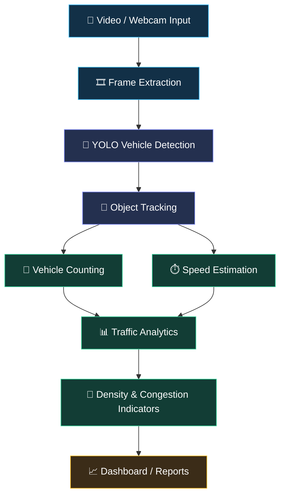

# 🚦 IITR TMI
### Traffic Monitoring & Intelligence | AI-Powered Computer Vision

<div align="center">


<br/>

**Turning traffic footage into meaningful insights through computer vision, vehicle tracking, and intelligent analytics.**

<br/>


**[Explore the Project](#-project-overview) · [Features](#-core-features) · [Installation](#-getting-started) · [Team](#-the-people-behind-the-project)**

</div>

---

## 🌐 Project Overview

**IITR TMI (Traffic Monitoring & Intelligence)** is a computer-vision project designed to transform ordinary traffic videos and camera feeds into structured traffic information.

By combining vehicle detection, object tracking, and video analytics, the system aims to help users understand how vehicles move, how traffic volume changes, and where potential congestion may occur.

Instead of manually observing hours of footage, IITR TMI is designed to automate important traffic-monitoring tasks and present the results in a more understandable format.

> 💡 **Our vision:** Make traffic analysis smarter, more visual, and more data-driven.

## 🎯 Why IITR TMI?

Traditional traffic observation can require substantial manual effort. Video-based computer vision offers a way to automate repetitive tasks and extract useful patterns from road scenes.

| Traditional monitoring | IITR TMI's approach |
|---|---|
| Manual vehicle observation | AI-assisted vehicle detection |
| Difficult to follow individual vehicles | Tracking IDs across video frames |
| Time-consuming traffic counts | Automated line-crossing counts |
| Limited quantitative analysis | Structured traffic statistics |
| Raw video footage | Visual analytics and potential reports |

*Actual capabilities depend on the features implemented and configured in the current version.*

---

## ✨ Core Features

<details>
<summary><b>🚘 01 — Intelligent Vehicle Detection</b></summary>

Identify and classify supported road vehicles in video frames using a YOLO object-detection model.

- Detect supported vehicle categories, such as cars, motorcycles, buses, and trucks.
- Display bounding boxes around detected objects.
- Show class labels and confidence scores.
- Process recorded video or a compatible live camera feed.

</details>

<details>
<summary><b>🧭 02 — Multi-Object Tracking</b></summary>

Follow detected vehicles across consecutive frames using a compatible tracking algorithm, such as ByteTrack.

- Associate detections with tracking IDs.
- Follow vehicle movement through the visible scene.
- Support trajectory analysis when tracking history is collected.
- Reduce repeated counting through ID-based logic.

*Tracking IDs may change after occlusion, missed detections, or tracking failures.*

</details>

<details>
<summary><b>⏱️ 03 — Vehicle Speed Estimation</b></summary>

Estimate vehicle speed using movement across frames and appropriate camera-to-road calibration.

- Calculate displacement over time.
- Convert image-space movement into approximate real-world distance.
- Express calibrated estimates in km/h.
- Analyze speed distributions when sufficient valid measurements are available.

**Accuracy note:** Reliable speed estimation requires suitable calibration, frame timing, and perspective handling. Pixel movement alone cannot establish real-world speed.

</details>

<details>
<summary><b>🔢 04 — Automated Vehicle Counting</b></summary>

Count vehicles crossing a configurable virtual line or entering a defined region.

- Track directional movement where supported.
- Maintain counts by vehicle category.
- Analyze traffic volume over selected intervals.
- Avoid duplicate counts using tracking state and crossing logic.

</details>

<details>
<summary><b>🚦 05 — Traffic Density & Congestion Analysis</b></summary>

Convert vehicle counts or occupancy measurements into interpretable traffic conditions.

- Classify density as LOW, MEDIUM, or HIGH using configurable thresholds.
- Identify periods of increasing traffic volume.
- Summarize traffic activity over time.
- Support congestion analysis using the metrics available in the implementation.

</details>

<details>
<summary><b>📊 06 — Analytics & Reporting</b></summary>

Organize collected traffic measurements into useful summaries.

- Vehicle counts by category.
- Average estimated speed when valid measurements exist.
- Traffic-volume and density trends.
- CSV exports and visual reports, if implemented.
- PDF summaries and charts, if implemented.

</details>

---

## 🔄 System Architecture

<div align="center">



</div>

### 🧠 The processing pipeline

1. **Capture:** Read frames from a traffic video or camera.
2. **Detect:** Locate vehicles using the selected YOLO model.
3. **Track:** Associate detections across frames.
4. **Measure:** Record trajectories, crossing events, and calibrated speed estimates.
5. **Analyze:** Calculate supported traffic metrics and density indicators.
6. **Present:** Display annotated video and available statistics or reports.

---

## 🛠️ Technology Stack

<div align="center">

| Technology | Purpose |
|---|---|
| 🐍 Python | Core application logic |
| 👁️ OpenCV | Video processing and image operations |
| 🤖 Ultralytics YOLO | Vehicle detection |
| 🧭 ByteTrack | Multi-object tracking, if configured |
| 🔢 NumPy | Numerical computations |
| 🐼 Pandas | Structured data processing |
| 📈 Matplotlib / Plotly | Visualization, if implemented |
| 📄 ReportLab | PDF generation, if implemented |

</div>

---

## 🚀 Getting Started

Get your local development environment ready in a few steps.

### Prerequisites

- Python 3.x compatible with your dependencies
- Git
- A compatible webcam or sample traffic video
- Sufficient hardware for your selected detection model

### 1. Clone the repository

```bash
git clone <YOUR_GITHUB_REPOSITORY_URL>
cd <YOUR_PROJECT_FOLDER>
```

Replace the placeholders with your actual repository URL and directory name.

### 2. Create a virtual environment

**Windows — PowerShell**

```powershell
python -m venv .venv
.\.venv\Scripts\Activate.ps1
```

**Linux / macOS**

```bash
python3 -m venv .venv
source .venv/bin/activate
```

### 3. Install dependencies

If a `requirements.txt` file exists in your repository:

```bash
pip install -r requirements.txt
```

Otherwise, install the core packages used by the example setup:

```bash
pip install opencv-python ultralytics numpy pandas matplotlib
```

Install any additional dependencies required by your actual implementation.

### 4. Add your input video

Place your sample video in the location expected by your application, or configure the webcam/video source in your code.

### 5. Run the application

For a project whose entry point is `main.py`:

```bash
python main.py
```

If your entry point has a different name, use the appropriate command.

> ⚠️ The commands above are a starting point. Exact installation and execution steps depend on your repository structure, model weights, and application entry point.

---

## 🖥️ Dashboard Experience

A well-designed traffic-monitoring dashboard can bring the most useful information into one view.

<div align="center">

| Dashboard Component | Information Displayed |
|---|---|
| 🎥 Live video panel | Annotated traffic footage |
| 🚘 Vehicle counter | Total counted vehicles |
| 🏍️ Class breakdown | Counts by vehicle type |
| ⏱️ Speed panel | Valid estimated speeds |
| 🚦 Traffic status | Configurable density classification |
| 📈 Analytics panel | Traffic trends over time |
| 📁 Export section | Supported data and report downloads |

</div>

*This is a proposed dashboard layout. Add screenshots or a demo GIF from your running application to showcase features that are already implemented.*

### 📸 Application Preview

Replace the placeholder below with a screenshot or GIF from your actual project.

```md

```

Recommended repository structure for your media:

```text
IITR-TMI/
├── assets/
│   ├── dashboard-preview.png
│   ├── vehicle-detection.gif
│   └── workflow.png
├── main.py
├── requirements.txt
├── README.md
└── LICENSE
```

Only include files and directories that actually exist in your repository.

---

## 📐 Understanding Speed Estimation

Speed estimation is one of the most important parts of traffic intelligence, but it must be implemented carefully.

A simplified calculation is:

\[
\text{Speed}=\frac{\text{Distance}}{\text{Time}}
\]

If a vehicle travels an estimated 20 metres in 2 seconds:

\[
v=\frac{20}{2}=10\text{ m/s}=36\text{ km/h}
\]

This is an illustrative example, not a measurement from the project.

For meaningful real-world estimates, the implementation needs:

- A suitable camera calibration method or reference distance.
- Correct frame timestamps or a reliable frame rate.
- A consistent tracking reference point.
- Perspective correction where needed.
- Validation against a trusted measurement method.

---

## 📊 Traffic Analytics & Key Performance Indicators

Depending on the data collected, the system can calculate:

<details>
<summary><b>Vehicle volume</b></summary>

- Total vehicles counted during a recording.
- Vehicle counts by category.
- Traffic flow over defined time intervals.
- Direction-wise counts where supported.

</details>

<details>
<summary><b>Speed distribution</b></summary>

- Mean and median estimated speed.
- Speed-range distribution.
- Valid minimum and maximum estimates.
- Slow-moving vehicle counts, if defined and implemented.

</details>

<details>
<summary><b>Traffic density</b></summary>

- Vehicle counts or road occupancy over time.
- Configurable density thresholds.
- Changes in observed traffic conditions.
- Potential congestion periods.

</details>

**Important:** Report only values generated by the running application. Do not claim accuracy, performance improvements, or real-world traffic outcomes without appropriate testing.

---

## 🗺️ Development Roadmap

Our roadmap focuses on moving from video-based vehicle detection toward a more complete traffic-analysis system.

- [ ] Configure video and webcam inputs
- [ ] Integrate vehicle detection
- [ ] Implement multi-object tracking
- [ ] Add virtual-line vehicle counting
- [ ] Implement and validate speed calibration
- [ ] Develop traffic-density classification
- [ ] Build a monitoring dashboard
- [ ] Add traffic analytics visualizations
- [ ] Implement CSV export
- [ ] Implement PDF report generation
- [ ] Evaluate performance under different lighting and traffic conditions
- [ ] Document limitations and benchmark results

*Mark an item complete only after the corresponding feature is implemented and tested.*

---

## 👥 The People Behind the Project

<div align="center">

### 🚀 Built Through Collaboration

A computer-vision project shaped by teamwork, experimentation, and a shared interest in intelligent traffic monitoring.

</div>

| Role | Contributor |
|---|---|
| 👨‍💻 Project Creator | **Suraj Kumar Gupta** |
| 🎨 Design | **Jatin** |
| 🤝 Contributors | **Harsh Pandey and Chetanya Kuchiya** |

*Contributions and roles are listed as provided by the project team.*

---

## 🔒 License & Usage Rights

**Copyright © 2026 Suraj Kumar Gupta. All rights reserved.**

This project is proprietary. No permission is granted to copy, modify, distribute, publish, sublicense, or use its source code or other materials without prior written permission from the copyright owner, except where applicable law provides otherwise.

See the repository's `LICENSE` file for the applicable terms.

**Note:** A license notice does not make a public repository private. Change the repository's visibility to **Private** if you also want to restrict public access.

---

## 💬 Feedback & Contact

Have a suggestion, found an issue, or want to discuss the project?

- Open an issue if the repository permits it.
- Share reproducible bug reports and testing details.
- Contact the project owner for permission requests.

Please respect the project's ownership and usage terms.

---

<div align="center">

## 🚦 DETECT. TRACK. ANALYZE. UNDERSTAND.

**IITR TMI — Turning Traffic Vision into Traffic Intelligence.**

*Smarter observation. Structured data. Better insights.*

<br/>


</div>
